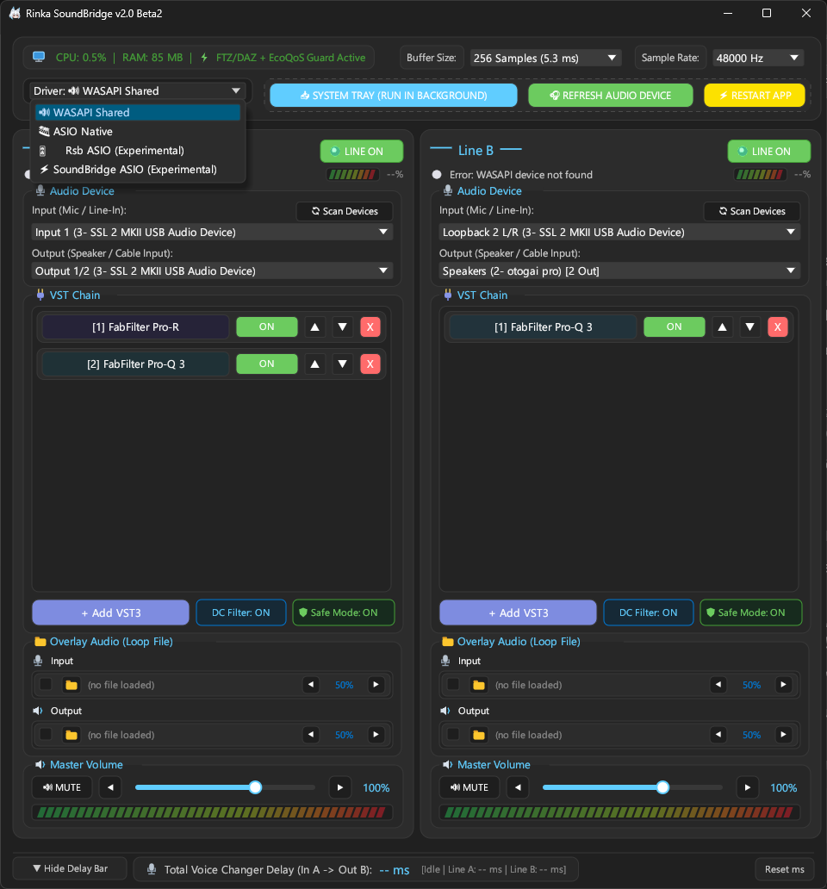
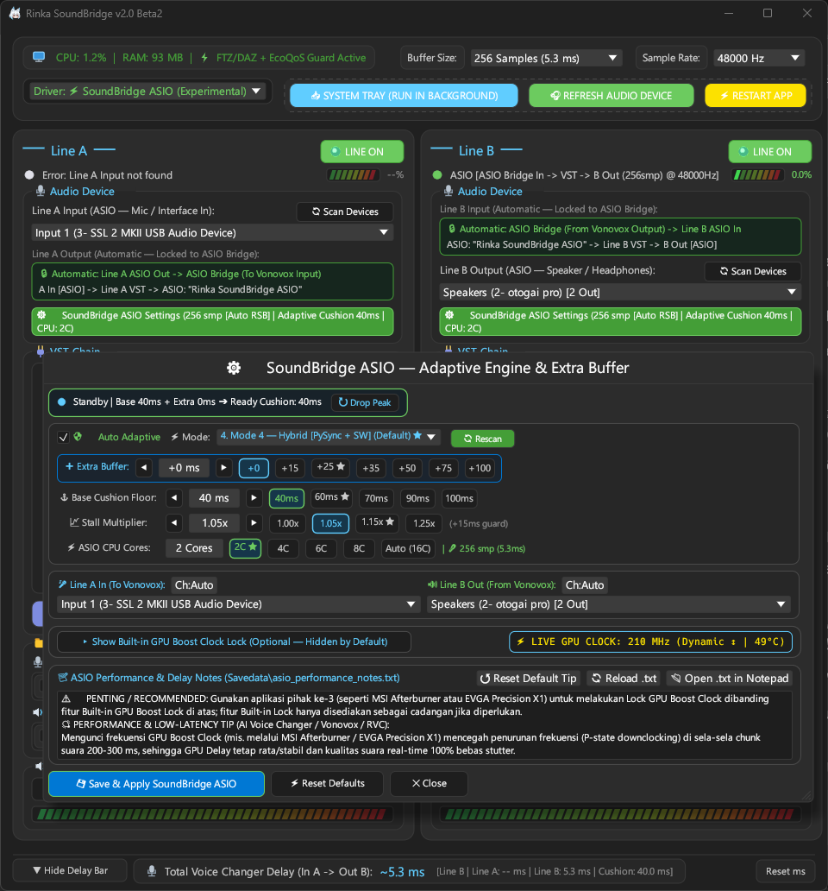
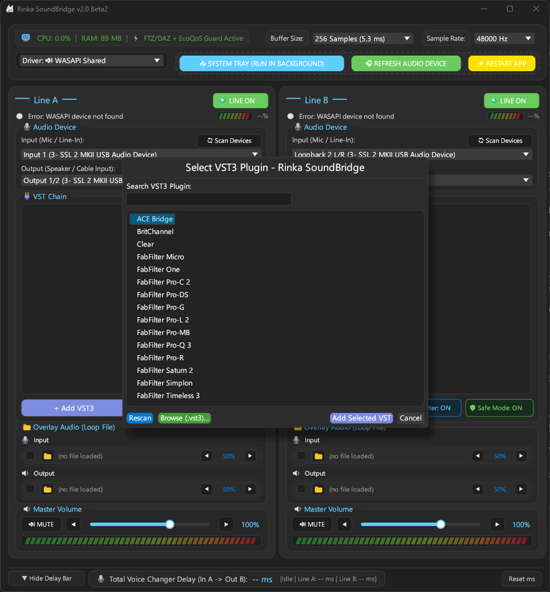

# Rinka SoundBridge v2.0 (Rust Native Edition)

Dual-Pipeline VST3 Host, Audio Router & Built-in Virtual ASIO Bridge for AI Voice Changers, VTubers, and Streamers (Windows 10/11 x64)**

**Rinka SoundBridge v2.0** is a complete ground-up rewrite of Rinka SoundBridge in **100% Native Rust (`x86_64-pc-windows-msvc`)**. Engineered for real-time voice processing, VTubing (**Live2D / VTube Studio**), live broadcasting (**OBS Studio / Discord**), and GPU-accelerated AI Voice Changers (**Vonovox / RVC / OKADA**), v2.0 replaces the legacy v1.22 Python architecture with a zero-allocation real-time audio engine and two built-in COM Virtual ASIO drivers (`rinka_soundbridge_core.dll`).

> [!NOTE]
> **Project Note & Disclaimer:**  
> This software was originally developed independently with the assistance of AI to solve my own personal audio routing and voice changer pipeline needs (rather than pirating commercial software or juggling two separate applications). This repository is shared openly (*as-is*) for anyone who might find it useful, just in case.  
> If anyone in the community wishes to take it further, fork it, or build upon it, please feel free—in fact, I'd be genuinely thrilled to see someone develop it further rather than relying on this AI-assisted result. This application was built solely to address my own personal use case.

## 📸 Screenshots & Interface Preview







## 🚀 What Changed from v1.22 to v2.0? (Major Architectural Leap)

Rinka SoundBridge v2.0 completely retires the v1.22 codebase and introduces a native systems-level audio architecture:

| Aspect / Feature | Legacy v1.22 | New Rinka SoundBridge v2.0 (Rust Native) |
| :--- | :--- | :--- |
| **Core Language & Runtime** | Python interpreter (subject to GIL contention and garbage collection pauses) | **100% Native Rust (`x86_64-pc-windows-msvc`)** + Native Win32 COM DLL (`rinka_soundbridge_core.dll`) |
| **Memory & CPU Footprint** | High RAM usage (`~180–350 MB`) and higher idle CPU overhead | **Ultra-lightweight (`~25–45 MB RAM`, `< 1%` idle CPU)** with `eframe`/`egui` GPU-rendered UI |
| **Real-Time Audio Thread Safety** | Dynamic buffer allocations during audio callbacks | **100% Zero-Heap-Allocation (`AudioScratchBuffers`)** + MMCSS `"Pro Audio"` thread priority & CPU core affinity |
| **Audio Signal Path Quality** | Standard float conversion with intermediate soft-clipping | **100% Bit-Exact 32-Bit IEEE Float Pass-Through**, 64-bit `5.0 Hz` Sub-Sonic DC Blocker, and `0.995` (`-0.043 dBFS`) True-Peak Mastering Limiter |
| **Virtual Cable & FlexASIO Dependency** | Required external Virtual Audio Cables + external FlexASIO installation | **2 Built-in Virtual ASIO Drivers (`"RSB ASIO"` & `"Rinka SoundBridge ASIO"`)** with direct in-memory SPSC loopback (no external FlexASIO or Virtual Cable required) |
| **AI Voice Changer GPU Stall Protection** | Fixed static buffer (prone to stutter on GPU spikes or pitch warble) | **5 Adaptive GPU Delay Sensor Modes (Default: Mode 4 Hybrid Dual-Sensor)** + True-Silence Cushion Builder (`< -58.4 dBFS`) + Zero-Echo Formant PLC |
| **WASAPI Shared Engine** | Standard polling (`~30–45 ms` per line) | **Direct 10 ms Event-Driven COM `IAudioClient`** (bypasses Windows SRC APO when sample rates match, cutting latency by `~45%`) |
| **Live2D / VTube Studio Sync** | Manual estimation | **Real-Time FFT Onset Cross-Correlation Delay Meter (`In A -> Out B`)** displaying exact milliseconds for Live2D lip-sync calibration |
| **GPU Clock Stability Support** | None | **GPU Boost Clock Lock Integration** (Live MHz/°C telemetry, 3rd-party lock guidance, and optional hidden-by-default built-in NVML lock with thermal failsafe) |

## ✨ Core Features in v2.0

### 1. Four Selectable Audio Driver Engines
- **`🔊 WASAPI Shared` (Default)**: Ultra-optimized `10 ms` Event-Driven Windows Audio engine with direct bit-exact kernel format matching and a tight lock-free FIFO (`~13–15 ms`). Ideal for daily streaming, OBS, Discord, or pairing with hardware loopbacks (such as SSL Loopback / Virtual Cable).
- **`🎹 ASIO Native`**: Direct hardware ASIO hosting for dedicated audio interfaces (SSL 2/2+, Focusrite Scarlett, RME, Steinberg, Yamaha, Behringer).
- **`🎛️ Rsb ASIO (Experimental)`**: Built-in **FlexASIO v0.35 GUI** registered under its own independent COM CLSID (`"RSB ASIO"`) so it never conflicts with or overwrites an external FlexASIO installation. Uses a **Direct Hardware-Event-Driven SPSC Pump** (`10 ms` input cushion + `24 ms` base output cushion with Mode 4 auto-scaling) to route `Mic In A -> VST A -> Vonovox ("ASIO: RSB ASIO") -> VST B -> Headset Out B` with zero Virtual Audio Cables.
- **`⚡ SoundBridge ASIO (Experimental)`**: Advanced hybrid bridge (`"Rinka SoundBridge ASIO"`) featuring **5 Adaptive GPU Cushion Modes** (Default: **Mode 4 — Hybrid Dual-Sensor Fusion** combining in-process Python `PySync` + Rust `ASIO Stopwatch Median`), customizable Base Cushion Floor (`20–450 ms`), Manual Extra Buffer (`+ms`), Stall Multiplier (`1.00x–1.30x`), and CPU Core Affinity (`1–8 Cores`).

### 2. Studio-Grade Dual-Line VST3 Host (`Line A` & `Line B`)
- **Pre-Processing (`Line A`) & Post-Processing (`Line B`)**: Run Noise Gates, RNNoise, De-Essers, Compressors, and EQ on `Line A` *before* your voice enters the AI Voice Changer (so the RVC pitch tracker receives a clean signal), and run Reverb, Stereo Enhancers, or Mastering Limiters on `Line B` *after* voice conversion.
- **100% Bit-Exact 32-Bit Float Headroom**: Pre- and post-VST stages preserve full floating-point dynamic range (`-12 dBFS` to `+11.9 dBFS` untouched), with a 64-bit `5.0 Hz` DC Blocker and a stereo-linked C2-continuous `0.995` (`-0.043 dBFS`) final DAC safety limiter.
- **Fail-Closed Safety Protection (`Mode Aman`)**: Automatically catches any VST3 plugin crash or `NaN`/`Inf` runaway fault and mutes the affected block cleanly without crashing the host or popping your headphones.
- **State Persistence**: Saves and restores full VST3 binary component/controller states (`hex`) and parameter snapshots automatically in `Savedata\rinka_soundbridge_config.json`.

### 3. Built-in Audio Overlays & Live2D Lip-Sync Delay Meter
- **Dual Audio Overlay Players (`Overlay In` & `Overlay Out`)**: Load WAV/MP3/OGG/FLAC background loops or sound effects (`symphonia` decoder with automatic sample-rate conversion and seamless `80 ms` loop crossfading).
- **Live2D / VTube Studio Delay Bar (`In A -> Out B`)**: Continuously measures actual end-to-end voice delay from your microphone (`Line A`) to your processed output (`Line B`) using FFT onset cross-correlation so you can enter the exact millisecond offset into VTube Studio / OBS for lip-sync alignment.

## ⚡ Crucial Performance Guide: Locking GPU Boost Clock for AI Voice Changers

When using GPU-heavy AI Voice Changers (**Vonovox / RVC / PyTorch / ONNX**), voice conversion runs in periodic chunks (e.g., every `200–300 ms`). Between chunks, modern GPUs aggressively drop their core frequency into low-power P-states (`300–600 MHz`) and take several milliseconds to ramp back up on the next chunk—causing erratic GPU inference spikes and audio glitches.

1. **Recommended Best Practice (3rd-Party GPU Utility)**:
   - Always lock your GPU Boost Clock to a steady frequency (for example, `1980 MHz` or your GPU's standard boost clock) using a dedicated 3rd-party application such as **MSI Afterburner** (`Ctrl+F` curve editor -> select point -> press `L` -> Apply) or **EVGA Precision X1** (`Boost Lock`).
   - With GPU Boost Clock locked, GPU inference delay stays flat (e.g., a rock-steady `~20 ms`), eliminating latency spikes and delivering 100% stutter-free, crystal-clear audio.
2. **Optional Built-in GPU Boost Clock Lock (Fallback)**:
   - Rinka SoundBridge v2.0 also includes an optional built-in NVML GPU Boost Clock Lock inside the ASIO Settings window (hidden by default behind **`"▸ Show Built-in GPU Boost Clock Lock"`**).
   - It uses your GPU's factory VBIOS boost ceiling (zero overclocking), monitors live MHz and temperature (`°C`) every 1 second, automatically unlocks if GPU temperature reaches `>= 83°C`, and guarantees automatic unlock when Rinka SoundBridge closes.

## 🛠️ How to Build & Run

### Prerequisites
- **OS**: Windows 10 or Windows 11 (64-bit).
- **Rust Toolchain**: Install `rustup` (`stable-x86_64-pc-windows-msvc`) from [rustup.rs](https://rustup.rs).
- **C++ Build Tools**: Visual Studio 2022 Build Tools with the *"Desktop development with C++"* workload.

### One-Click Build & Registration
1. Right-click **`build.bat`** and select **Run as administrator**.
2. `build.bat` automatically compiles both `rinka_soundbridge_core.dll` (the Virtual ASIO COM driver) and `RinkaSoundBridge.exe` in `--release` mode, assembles the `dist\` directory, and registers `"RSB ASIO"` and `"Rinka SoundBridge ASIO"` in the Windows Registry.
3. Launch **`dist\RinkaSoundBridge.exe`** (or double-click **`test.bat`**).

### Output Directory Structure (`dist\`)
```text
dist\
├── RinkaSoundBridge.exe               # Main Native Rust GUI & Audio Host
├── Modules\
│   ├── rinka_soundbridge_core.dll     # Virtual ASIO COM Driver & Core Engine
│   └── icon.ico
└── Savedata\
    ├── rinka_soundbridge_config.json  # Atomic Auto-Saved Settings & VST3 States
    ├── asio_performance_notes.txt     # Editable ASIO & GPU Performance Notes
    └── rinka_soundbridge.log          # Flight Recorder & Diagnostic Log
```

## 🎧 Quick Routing Examples

| Scenario | Rinka SoundBridge Driver | Line A Setup | Voice Changer (Vonovox) Setup | Line B Setup |
| :--- | :--- | :--- | :--- | :--- |
| **1. Internal Loopback (No Virtual Cable)** | `🎛️ Rsb ASIO (Experimental)` | **Input**: Your Microphone (e.g., `SSL 1 Input`) | **Driver**: `ASIO`<br>**Device**: `RSB ASIO` | **Output**: Your Headphones / Speakers |
| **2. Adaptive GPU Cushion Bridge** | `⚡ SoundBridge ASIO (Experimental)` | **Input**: Your Microphone | **Driver**: `ASIO`<br>**Device**: `Rinka SoundBridge ASIO` | **Output**: Your Headphones / Speakers |
| **3. Classic Hardware / Virtual Loopback** | `🔊 WASAPI Shared` | **Input**: `SSL 1 Input`<br>**Output**: `Output 1/2 (Loopback 1)` | **Driver**: `WASAPI` or `FlexASIO`<br>**In**: `Loopback 1` -> **Out**: `Loopback 2` | **Input**: `Loopback 2`<br>**Output**: Your Headphones |
