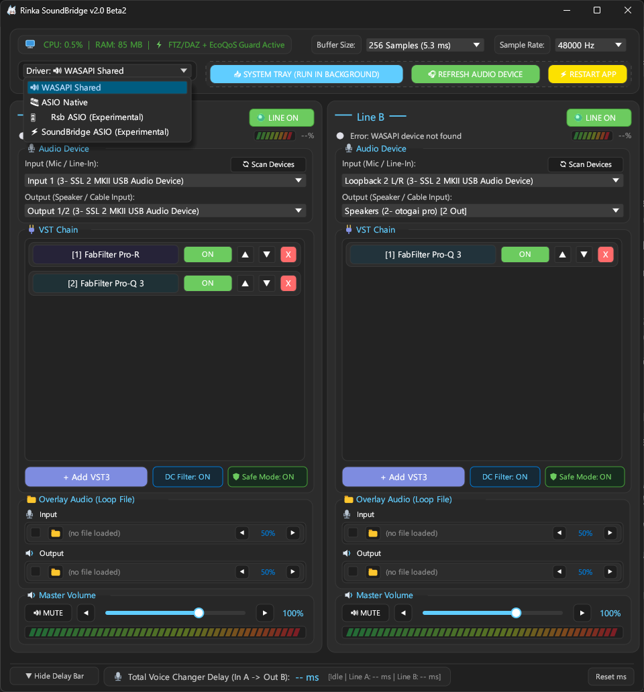
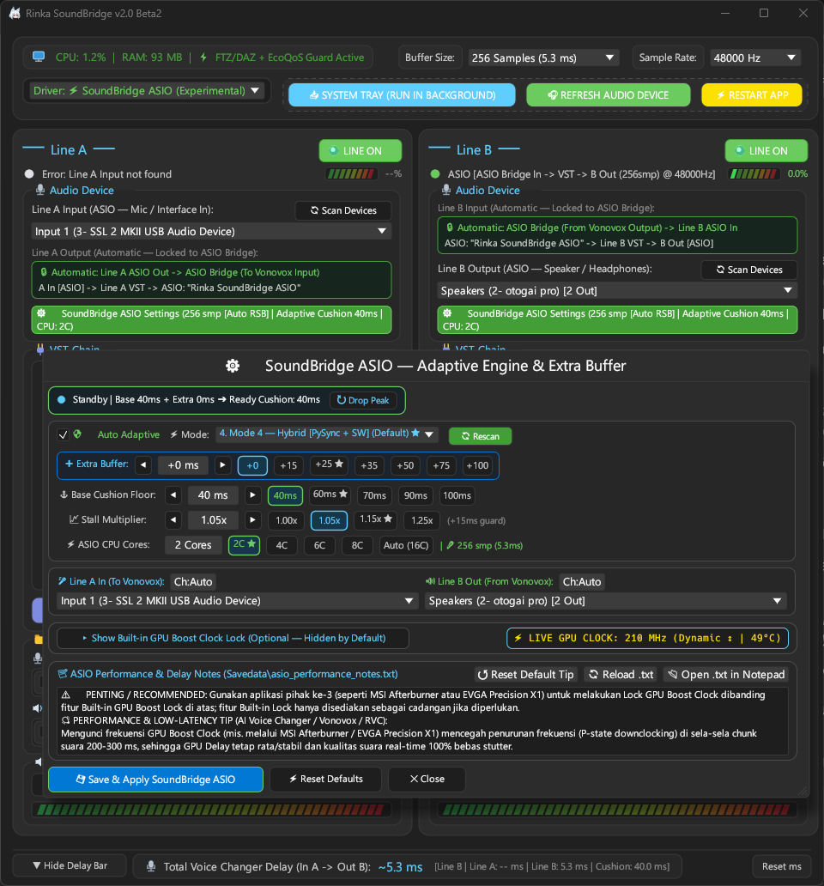
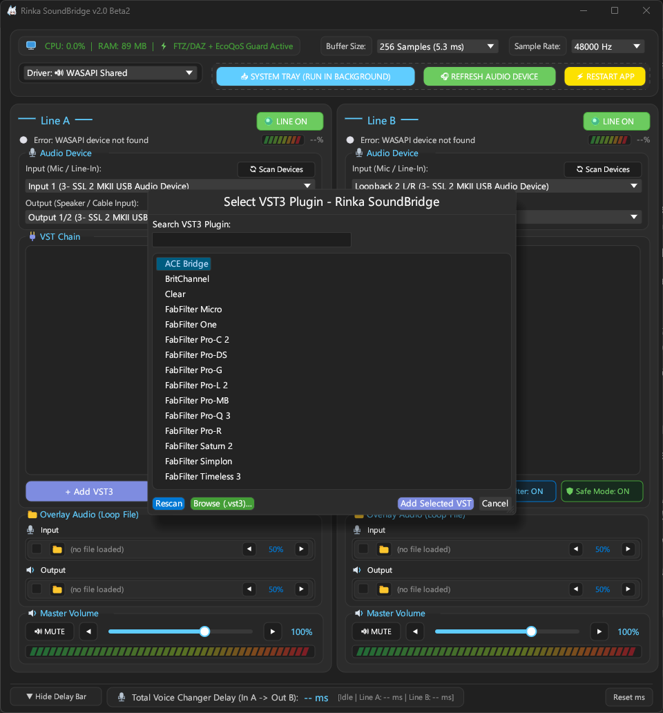
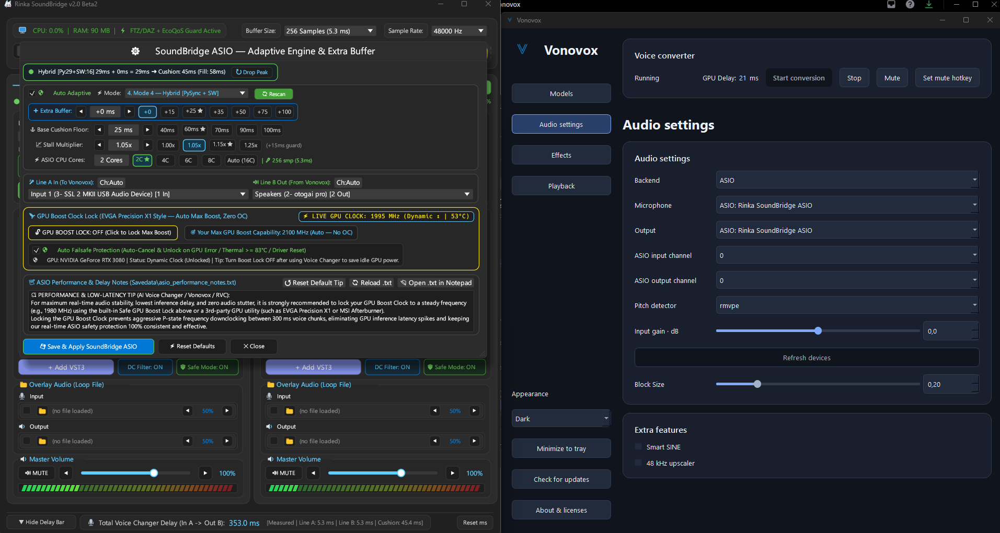

# Rinka SoundBridge v2.3 (Rust Native Edition)

**Dual-Pipeline VST3 Host, Lock-Free Audio Router, Built-in Virtual ASIO Bridge & Direct RAM Pipe for AI Voice Changers, VTubers, and Streamers (Windows 10/11 x64), for solve my own problem **

**Rinka SoundBridge v2.3** is built on the ground-up **100% Native Rust (`x86_64-pc-windows-msvc`)** architecture introduced in v2.0. Engineered for real-time voice processing, VTubing (**Live2D / VTube Studio**), live broadcasting (**OBS Studio / Discord**), and GPU-accelerated AI Voice Changers (**ORION / Vonovox / RVC / OKADA**), v2.3 upgrades the entire audio transport to **100% lock-free SPSC ring buffers**, adds a **built-in OBS Delay Overlay**, introduces **self-healing anti-stuck-delay recovery & periodic silent micro-reset**, and adds a **5th direct zero-copy RAM driver (`🚀 ORION`)** alongside the two built-in COM Virtual ASIO drivers (`rinka_soundbridge_core.dll`).

> [!NOTE]
> **Project Note & Disclaimer:**  
> This software was originally developed independently with the assistance of AI to solve my own personal audio routing and voice changer pipeline needs (rather than pirating commercial software or juggling two separate applications). This repository is shared openly (*as-is*) for anyone who might find it useful, just in case.  
> If anyone in the community wishes to take it further, fork it, or build upon it, please feel free—in fact, I'd be genuinely happy to see someone develop it further rather than relying on this AI-assisted result. This application was built solely to address my own personal use case.
>
> **Version & Release Note:** Versions `v2.1` and `v2.2` were private internal builds. Public release **`v2.3.0`** ships as prebuilt Windows x64 binaries (`RinkaSoundBridge.exe` + `rinka_soundbridge_core.dll`) in GitHub Releases (always unencrypted—no password-protected ZIPs).

## Rinka SoundBridge only using VST3

## 📸 Screenshots & Interface Preview









> [!NOTE]
> **Personal Message:**  
> From my testing, if not using VST, its capable reach lowest at **350 ms -ish** delay, with Vonovox v2.0 and **0.20** block size that run on Driver: SoundBridge ASIO.
> 
> You need lock your GPU clock to boost speed, on RTX 3080 12gb i got 350ms-ish, on my Laptop RTX 3070 8gb it reaches 400ms-ish with streaming + Vtube Studio + Chrome open play Youtube.
> 
> my setting is set low as Vonovox GPU Delay : "VALUE". Mode 4, Extra Buffer: 0 , Base Cushion Flor: 25ms, Stall Multiplier: 1.05x.
> 
> PLEASE CHECK YOUR Vonovox GPU Delay : "VALUE" while gaming, make sure it not spiking a lot.
>
> Also on Driver : WASAPI Shared, i got around 500ms -ish, it that fast if you lock your GPU Clock to boost, if not it will be around 800ms -ish and will not able to use SoundBridge ASIO, since Vonovox GPU Delay will spiking a lot from 20 to 190 make your audio stutter like crazy

## 🆕 What's New in v2.3 (Since Public v2.0)

- **100% Lock-Free Cache-Line-Aligned SPSC `AudioFIFO`**: Completely eliminated mutex locks from real-time audio callbacks (`64-byte` cache-line-aligned atomic ring buffers with zero heap allocations), removing priority-inversion stutter while preserving bit-exact Catmull-Rom drift-lock quality.
- **Built-in Live OBS Delay Overlay (`Savedata\obs_delay_overlay.html`)**: Add `obs_delay_overlay.html` directly as an OBS Browser Source (powered by a hardened loopback-only `http://127.0.0.1:49812` endpoint + atomic JS fallback) to display your real-time end-to-end voice delay live on screen.
- **Cross-Sample-Rate FFT Delay Meter & Honest `Measured` vs `Est.`**: Accurately measures acoustic onset delay even when Line A (`44.1 kHz`) and Line B (`48 kHz`) run at different sample rates, tracks capture + render hardware DMA buffers dynamically, and never fakes or clamps `Measured` delay to `Est.`.
- **Anti-Stuck-Delay Recovery & Periodic Coordinated Silent Micro-Reset**:
  - Upgraded *True-Silence Excess Trim* (`-56.5 dBFS` threshold), tightened backlog recovery ceilings, and added 1-block toggle-spike damping so mid-stream GPU stalls or setting toggles never leave permanent added delay.
  - Added configurable **Periodic Silent Micro-Reset** (default `60 min` interval, `10 min` cooldown, triggered cleanly during `>= 1.2s` silence in `< 2 ms` without dropping WASAPI/ASIO hardware handles).
- **5th Driver Engine (`🚀 ORION` Direct RAM Pipe) & Adaptive Mode 6**: Added a direct zero-copy shared-memory RAM pipe for ORION alongside **Mode 6 (ORION SW-Fusion)** in `SoundBridge ASIO`, using lock-free atomic bitfield synchronization.
- **Unclamped VST3 PDC, Pre-Sized Scratch Buffers & Security Hardening**:
  - Removed artificial `4800`-sample cap on VST3 plugin latency reporting (PDC) and pre-sized real-time `AudioScratchBuffers` (`8,192..65,536` frames) to prevent mid-stream heap growth.
  - Hardened loopback-only CORS on the local overlay server, `LOAD_LIBRARY_SEARCH_SYSTEM32` DLL loading, `VirtualQuery` shared-memory bounds checks, `catch_unwind` COM FFI guards around VST3 plugins, and `is_finite()` config validation with 100% backward compatibility for `v2.0` configs.

## 🚀 What Changed from v1.22 to v2.3? (Major Architectural Leap)

| Aspect / Feature | Legacy v1.22 | New Rinka SoundBridge v2.3 (Rust Native) |
| :--- | :--- | :--- |
| **Core Language & Runtime** | Python interpreter (subject to GIL contention and garbage collection pauses) | **100% Native Rust (`x86_64-pc-windows-msvc`)** + Native Win32 COM DLL (`rinka_soundbridge_core.dll`) |
| **Memory & CPU Footprint** | High RAM usage (`~180–350 MB`) and higher idle CPU overhead *(Note: More VST = More Memory)* | **Ultra-lightweight (`~25–45 MB RAM`, `< 1%` idle CPU)** with `eframe`/`egui` GPU-rendered UI *(Note: More VST = More Memory)* |
| **Real-Time Audio Transport** | Dynamic buffer allocations & locked queues during audio callbacks | **100% Lock-Free Cache-Line-Aligned SPSC `AudioFIFO`** + Pre-Sized Zero-Alloc `AudioScratchBuffers` (`8,192..65,536`) + MMCSS `"Pro Audio"` & CPU core affinity |
| **Audio Signal Path Quality** | Standard float conversion with intermediate soft-clipping | **100% Bit-Exact 32-Bit IEEE Float Pass-Through**, 64-bit `5.0 Hz` Sub-Sonic DC Blocker, and `0.995` (`-0.043 dBFS`) True-Peak Mastering Limiter |
| **Virtual Cable & FlexASIO Dependency** | Required external Virtual Audio Cables + external FlexASIO installation | **2 Built-in Virtual ASIO Drivers (`"RSB ASIO"` & `"Rinka SoundBridge ASIO"`)** + **`🚀 ORION` Direct RAM Pipe** (no external FlexASIO or Virtual Cable required) |
| **AI Voice Changer GPU Stall Protection** | Fixed static buffer (prone to stutter on GPU spikes or pitch warble) | **6 Adaptive GPU Delay Sensor Modes (Modes 1–6)** + Anti-Stuck-Delay Excess Trim (`-56.5 dBFS`) + Periodic Silent Micro-Reset + Zero-Echo Formant PLC |
| **WASAPI Shared Engine** | Standard polling (`~30–45 ms` per line) | **Direct 10 ms Event-Driven COM `IAudioClient`** (bypasses Windows SRC APO when sample rates match, cutting latency by `~45%`) |
| **Live2D / VTube Studio & OBS Sync** | Manual estimation | **Cross-SR FFT Onset Cross-Correlation Delay Meter (`In A -> Out B`)** + **Built-in OBS Browser Source Delay Overlay** |
| **GPU Clock Stability Support** | None | **GPU Boost Clock Lock Integration** (Live MHz/°C telemetry, 3rd-party lock guidance, and optional hidden-by-default built-in NVML lock with thermal failsafe & crash auto-unlock) |
| **Executable file size** | Around ~50 MB | **Around ~8 MB** |

## ✨ Core Features in v2.3

### 1. Five Selectable Audio Driver Engines
- **`🔊 WASAPI Shared` (Default)**: Ultra-optimized `10 ms` Event-Driven Windows Audio engine with direct bit-exact kernel format matching and a **lock-free SPSC FIFO** (`~13–15 ms`). Ideal for daily streaming, OBS, Discord, or pairing with hardware loopbacks (such as SSL Loopback / Virtual Cable).
- **`🎹 ASIO Native`**: Direct hardware ASIO hosting for dedicated audio interfaces (SSL 2/2+, Focusrite Scarlett, RME, Steinberg, Yamaha, Behringer).
- **`🎛️ Rsb ASIO (Experimental)`**: Built-in **FlexASIO v0.35 GUI** registered under its own independent COM CLSID (`"RSB ASIO"`) so it never conflicts with or overwrites an external FlexASIO installation. Uses a **Direct Hardware-Event-Driven SPSC Pump** (`~5–10 ms` input cushion + `24 ms` base output cushion with auto-scaling) to route `Mic In A -> VST A -> Voice Changer ("ASIO: RSB ASIO") -> VST B -> Headset Out B` with zero Virtual Audio Cables.
- **`⚡ SoundBridge ASIO (Experimental)`**: Advanced hybrid bridge (`"Rinka SoundBridge ASIO"`) featuring **6 Adaptive GPU Cushion Modes** (Modes 1–6: PySync, ASIO Stopwatch, Decoupled Pacing, Hybrid Dual-Sensor, Predictive Pre-Emptive, and **Mode 6 ORION SW-Fusion**), customizable Base Cushion Floor (`20–450 ms`), Stall Guard (`+ms`), Stall Multiplier (`1.00x–1.30x`), and CPU Core Affinity (`1–8 Cores`).
- **`🚀 ORION` (Direct Shared-Memory RAM Pipe)**: Zero-copy RAM audio pipe (`Line A -> ORION -> Line B`) with automatic **Mode 6 (ORION SW-Fusion)**, 1-block toggle-spike damping, anti-stuck-delay recovery, and 2-way Coordinated Silent Reset.

### 2. Dual-Line VST3 Host (`Line A` & `Line B`)
- **Pre-Processing (`Line A`) & Post-Processing (`Line B`)**: Run Noise Gates, RNNoise, De-Essers, Compressors, and EQ on `Line A` *before* your voice enters the AI Voice Changer (so the RVC pitch tracker receives a clean signal), and run Reverb, Stereo Enhancers, or Mastering Limiters on `Line B` *after* voice conversion.
- **100% Bit-Exact 32-Bit Float Headroom & Unclamped PDC**: Pre- and post-VST stages preserve full floating-point dynamic range (`-12 dBFS` to `+11.9 dBFS` untouched), with a 64-bit `5.0 Hz` DC Blocker, a stereo-linked C2-continuous `0.995` (`-0.043 dBFS`) final DAC safety limiter, and exact unclamped VST3 plugin latency reporting.
- **Fail-Closed Safety Protection (`Safe Mode`)**: Automatically catches any VST3 plugin crash, COM FFI panic, or `NaN`/`Inf` runaway fault and mutes the affected block cleanly without crashing the host or popping your headphones.
- **State Persistence**: Saves and restores full VST3 binary component/controller states (`hex`) and parameter snapshots automatically in `Savedata\rinka_soundbridge_config.json` (100% compatible with `v2.0` configs).

### 3. Built-in Audio Overlays, OBS Delay Overlay & Live2D Lip-Sync Meter
- **Dual Audio Overlay Players (`Overlay In` & `Overlay Out`)**: Load WAV/MP3/OGG/FLAC background loops or sound effects (`symphonia` decoder with automatic sample-rate conversion and seamless `80 ms` loop crossfading).
- **Live2D / VTube Studio / OBS Delay Bar (`In A -> Out B`)**: Continuously measures actual end-to-end voice delay from your microphone (`Line A`) to your processed output (`Line B`) using **Cross-Sample-Rate FFT Onset Cross-Correlation**, with a ready-to-use OBS Browser Source (`Savedata\obs_delay_overlay.html`).

## ⚡ Crucial Performance Guide: Locking GPU Boost Clock for AI Voice Changers

When using GPU-heavy AI Voice Changers (**ORION / Vonovox / RVC / PyTorch / ONNX**), voice conversion runs in periodic chunks (e.g., every `200–300 ms`). Between chunks, modern GPUs aggressively drop their core frequency into low-power P-states (`300–600 MHz`) and take several milliseconds to ramp back up on the next chunk—causing erratic GPU inference spikes and audio glitches.

1. **Recommended Best Practice (3rd-Party GPU Utility)**:
   - Always lock your GPU Boost Clock to a steady frequency (for example, `1980 MHz` or your GPU's standard boost clock) using a dedicated 3rd-party application such as **MSI Afterburner** (`Ctrl+F` curve editor -> select point -> press `L` -> Apply) or **EVGA Precision X1** (`Boost Lock`).
   - With GPU Boost Clock locked, GPU inference delay stays flat (e.g., a rock-steady `~20 ms`), eliminating latency spikes and delivering 100% stutter-free, crystal-clear audio.
2. **Optional Built-in GPU Boost Clock Lock (Fallback)**:
   - Rinka SoundBridge v2.3 also includes an optional built-in NVML GPU Boost Clock Lock inside the ASIO Settings window (hidden by default behind **`"▸ Show Built-in GPU Boost Clock Lock"`**).
   - It uses your GPU's factory VBIOS boost ceiling (zero overclocking), monitors live MHz and temperature (`°C`) every 1 second, automatically unlocks if GPU temperature reaches `>= 83°C`, and guarantees automatic unlock when Rinka SoundBridge closes or crashes.
   - DO NOT USE UNLESS YOU NEEDED IT ONLY, PLEASE USE 3rd PARTY SOFTWARE LIKE EVGA PRECISION X1

## 🛠️ How to Run (Prebuilt v2.3 Release) / Build (v2.0 Source)

### Running Prebuilt v2.3 Binaries (Recommended)
1. Download the `v2.3.0` release ZIP from **GitHub Releases** (no password required) and extract it.
2. If upgrading from `v2.0`, you can keep your existing `Savedata\rinka_soundbridge_config.json`.
3. Launch **`RinkaSoundBridge.exe`** (for Virtual ASIO modes, register `Modules\rinka_soundbridge_core.dll` via Administrator prompt as in v2.0).

### Building from v2.0 Source (Prerequisites)
- **OS**: Windows 10 or Windows 11 (64-bit).
- **Rust Toolchain**: Install `rustup` (`stable-x86_64-pc-windows-msvc`) from [rustup.rs](https://rustup.rs).
- **C++ Build Tools**: Visual Studio 2022 Build Tools with the *"Desktop development with C++"* workload.
- Right-click **`build.bat`** -> **Run as administrator**, then launch **`dist\RinkaSoundBridge.exe`**.

### Output Directory Structure (`dist\`)
```text
dist\
├── RinkaSoundBridge.exe               # Main Native Rust GUI & Audio Host
├── Modules\
│   ├── rinka_soundbridge_core.dll     # Virtual ASIO COM Driver & Core Engine
│   └── icon.ico
└── Savedata\
    ├── rinka_soundbridge_config.json  # Atomic Auto-Saved Settings & VST3 States
    ├── asio_performance_notes.txt     # Editable ASIO & GPU Performance Notes
    ├── obs_delay_overlay.html         # OBS Browser Source Live Delay Overlay
    ├── obs_delay_live.js              # Atomic JS Fallback for OBS Overlay
    └── rinka_soundbridge.log          # Flight Recorder & Diagnostic Log
```

## 🎧 Quick Routing Examples

| Scenario | Rinka SoundBridge Driver | Line A Setup | Voice Changer Setup | Line B Setup |
| :--- | :--- | :--- | :--- | :--- |
| **1. Direct RAM Pipe (Zero Virtual Cable)** | `🚀 ORION` | **Input**: Your Microphone (e.g., `SSL 1 Input`) | **ORION** (Direct Shared Memory Pipe) | **Output**: Your Headphones / Speakers |
| **2. Internal Loopback (No Virtual Cable)** | `🎛️ Rsb ASIO (Experimental)` | **Input**: Your Microphone | **Driver**: `ASIO`<br>**Device**: `RSB ASIO` | **Output**: Your Headphones / Speakers |
| **3. Adaptive GPU Cushion Bridge** | `⚡ SoundBridge ASIO (Experimental)` | **Input**: Your Microphone | **Driver**: `ASIO`<br>**Device**: `Rinka SoundBridge ASIO` | **Output**: Your Headphones / Speakers |
| **4. Classic Hardware / Virtual Loopback** | `🔊 WASAPI Shared` | **Input**: `SSL 1 Input`<br>**Output**: `Output 1/2 (Loopback 1)` | **Driver**: `WASAPI` or `FlexASIO`<br>**In**: `Loopback 1` -> **Out**: `Loopback 2` | **Input**: `Loopback 2`<br>**Output**: Your Headphones |
